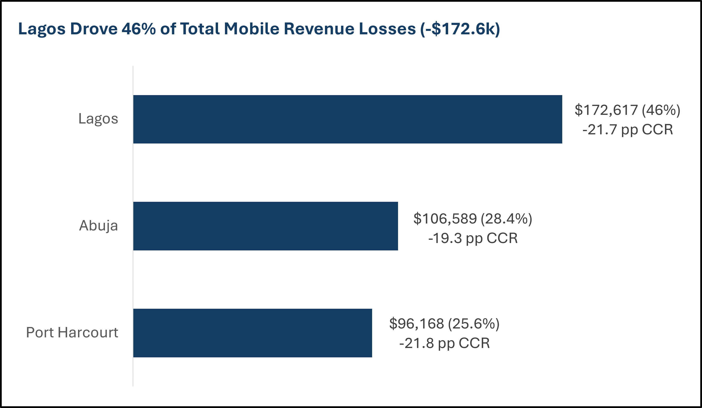

# Northstar Retail | Diagnostic Analytics

**Project type:** Independent data analytics portfolio  
**Reporting period:** Q2 2025 versus Q2 2024  
**Business context:** Multi-region e-commerce retailer operating in Lagos, Abuja and Port Harcourt  
**Primary tool:** Microsoft Excel (PivotTables, formulas, charts and financial decomposition)  

[Northstar Retail executive diagnostic dashboard](visuals/Executive_Dashboard.pdf)

## Table of Contents

- [1. Project Overview](#1-project-overview)
- [2. Business Problem & Stakeholders](#2-business-problem--stakeholders)
- [3. Dataset Overview & Tools](#3-dataset-overview--tools)
- [4. Analytical Framework & Methodology](#4-analytical-framework--methodology)
- [5. Executive Summary](#5-executive-summary)
- [6. Key Findings & Visualizations](#6-key-findings--visualizations)
  - [6.1 Weekly Mobile Checkout Diagnosis](#61-weekly-mobile-checkout-diagnosis)
  - [6.2 Revenue Driver Decomposition](#62-revenue-driver-decomposition)
  - [6.3 Regional Mobile Revenue Losses](#63-regional-mobile-revenue-losses)
  - [6.4 Paid Marketing Efficiency](#64-paid-marketing-efficiency)
  - [6.5 Refund Rate by Category](#65-refund-rate-by-category)
- [7. Recommendations & Business Implications](#7-recommendations--business-implications)
- [8. Limitations & Further Investigation](#8-limitations--further-investigation)
- [9. Project Files & Deliverables](#9-project-files--deliverables)

---

## 1. Project Overview

Northstar Retail is a multi-region e-commerce case spanning **Lagos, Abuja and Port Harcourt**. The assignment was to understand *what changed, when deterioration began, where the revenue loss occurred and what management should investigate next*.

The analysis combines customer-funnel metrics, order and revenue performance, marketing spend, release timing and refund trends. It distinguishes documented performance deterioration from hypotheses about possible operational or technical causes.

**Scope:** Q2 2025 versus Q2 2024, with a weekly view used to investigate the March 2025 shift.

[↑ Back to Table of Contents](#table-of-contents)

## 2. Business Problem & Stakeholders

Northstar Retail is a multi-region e-commerce business operating across Lagos, Abuja, and Port Harcourt. In Q2 2025, net revenue declined by 24.5% YOY, from $1.385 million to $1.046 million, representing a loss of approximately $338,988, despite an 8.3% increase in website sessions. Meanwhile, paid marketing expenditure increased by 24.6%, raising concerns about declining marketing efficiency. 
Management therefore commissioned a diagnostic investigation to determine why increased traffic and advertising investment were not translating into revenue growth, identify when the deterioration began, establish the primary business drivers, and recommend evidence-based corrective actions.

| Business measure | Q2 2024 | Q2 2025 | Movement |
|---|---:|---:|---:|
| Net revenue | $1,384,637 | $1,045,650 | **−24.5%** |
| Website sessions | 485,220 | 525,604 | **+8.3%** |
| Purchase conversion | 3.10% | 2.22% | **−28.5% relative** |
| Paid net ROAS | 2.61× | 1.63× | **−37.6% relative** |

The **VP of Growth** wanted to know what was happening, when the problem started, which segments drove it and what the team should do next. Other stakeholders proposed explanations to test rather than assume:

| Stakeholder | Initial explanation |
|---|---|
| Marketing | Traffic quality may have deteriorated |
| Product | Seasonality may explain the change |
| Operations | Returns may be the main problem |
| Finance | Marketing spend may be rising faster than revenue |

## 3. Dataset Overview & Tools

The project combines three principal data sources described in the [Data Dictionary](data/data_dictionary.md):

| Source | Role in the analysis | Grain / analytical caution |
|---|---|---|
| `weekly_performance` | Traffic, funnel activity, orders, revenue, discounts and refunds | Week × region × channel × device × category |
| `marketing_spend` | Spend, impressions and clicks | Week × region × channel; **coarser** than performance data |
| `release_log` | Timing context for website changes | Release-event grain; not causal proof |

**Tooling actually used:** Microsoft Excel, PivotTables, formula-backed KPI calculations, segmentation, trend charts and revenue decomposition.

**Important modelling decision:** Performance must be aggregated to **week × region × channel** before being compared or joined with marketing spend. Directly joining lower-grain performance rows to marketing-spend rows would multiply expenditure.

> The complete calculations and detailed PivotTable outputs are preserved in the [workbook](workbook/Northstar_Retail_Diagnostic_Analytics.xlsx). The public workbook may contain more supporting worksheets than are summarised here.

[↑ Back to Table of Contents](#table-of-contents)

## 4. Analytical Framework & Methodology

The analysis follows **V → T → D → B → C**:

1. **Validate:** Check data integrity, source grains, KPI definitions and calculations.
2. **Trend:** Compare Q2 periods and locate the weekly structural break.
3. **Decompose:** Separate traffic, conversion, order value, discounts and refunds; then segment by device, channel and region.
4. **Benchmark:** Compare against prior-period performance and stakeholder hypotheses.
5. **Conclude:** Rank the drivers, identify evidence gaps and recommend next investigations.

## 5. Executive Summary

Northstar Retail's Q2 2025 net revenue fell **24.5% (approximately $339K)** even as website sessions grew **8.3%**. Purchase conversion declined **28.5% relative** and mobile checkout completion deteriorated sharply after mid-March, while desktop remained broadly stable. The revenue-driver bridge attributes a **−$486.8K conversion contribution**, partly offset by **+$131.4K from traffic growth**.

Paid marketing spend increased **24.6%** while paid-channel net revenue fell **22.2%**, reducing net ROAS from **2.61× to 1.63× (−37.6%)**. Fashion's refund rate also increased from approximately **5.55% to 11.56%**, although the refund component in the modelled revenue bridge was much smaller than the conversion contribution.

**Decision:** Prioritise technical diagnosis of mobile checkout, review paid-media allocation while the funnel is impaired and investigate the Fashion refund spike separately. Do not attribute the checkout decline to the March release without additional technical or controlled evidence.

[↑ Back to Table of Contents](#table-of-contents)

## 6. Key Findings & Visualizations

The dashboard above provides the consolidated executive view. The complete charts and evidence discussion are in the [seven-page presentation](report/Northstar_Retail_Diagnostic_Analytics_Presentation.pdf).

### 6.1 Weekly Mobile Checkout Diagnosis

The weekly trend shows that Northstar Retail’s revenue deterioration was closely tied to a sharp breakdown in **mobile checkout completion** rather than a broad-based decline across all devices. Mobile checkout completion fell abruptly from **46.0% to 25.6%**, a drop of approximately **20.4 percentage points**, in the week beginning **17 March 2025**. By contrast, desktop checkout completion remained relatively stable at around **49%**, indicating that the disruption was concentrated within the mobile purchase journey rather than the entire checkout process.

This pattern is important because it helps narrow the diagnostic focus. If both desktop and mobile had declined at the same time, the issue might have pointed to a broader demand, pricing, or site-wide conversion problem. Instead, the device-specific deterioration suggests that the most likely business impact came from a mobile-side friction point introduced around mid-March. The release log shows that a **field-validation update was deployed on 14 March 2025**, only days before the decline became visible in the weekly data.

**Interpretation:**  
The timing and device concentration make mobile checkout the highest-priority investigation area. However, the evidence only establishes **temporal proximity**, not confirmed causation. The data show **when** the problem appeared and **where** it was concentrated, but not the exact technical mechanism responsible.

**Business implication:**  
Because mobile accounts for a substantial share of traffic and order activity, a sustained deterioration in mobile checkout completion would have a disproportionate effect on overall conversion, order volume and net revenue. This makes mobile checkout performance the most commercially material breakdown in the entire diagnostic analysis.

**Action:**  
Investigate form-validation errors, browser/device compatibility issues, payment-step drop-offs and session continuity across the mobile journey. Any suspected release issue should be confirmed through controlled testing, technical logs, rollback evidence or A/B comparison before being treated as the root cause.

### 6.2 Revenue Driver Decomposition

Despite an **8.3% increase in website sessions**, Northstar Retail's net revenue declined by **24.5%, from $1.385 million in Q2 2024 to $1.046 million in Q2 2025**, representing a loss of approximately **$338,988**. To determine the factors responsible, a revenue driver decomposition was conducted to isolate the financial contributions of traffic, purchase conversion, average order value (AOV), discounts, and refunds.

The analysis revealed that **purchase conversion was the dominant contributor to revenue deterioration**, generating an estimated **$486,832 negative revenue impact** as conversion declined from **3.10% to 2.22% (−28.5%)**. This represented approximately **97.3% of all negative components in the revenue bridge**. Importantly, this percentage does not represent 97.3% of the final net revenue decline, as positive contributions from other drivers partially offset the losses.

Increased website traffic contributed approximately **$131,418 in additional revenue**, while changes in discount amounts generated a further **$29,753 positive contribution**. However, these gains were insufficient to offset the conversion deterioration. Changes in gross AOV (−$7,604) and refunds (−$5,723) had comparatively smaller negative impacts, confirming that reduced purchase completion, rather than pricing or refund deductions, was the principal factor behind the revenue shortfall.

| Modelled driver | Contribution to Q2 revenue change |
|---|---:|
| Traffic | +$131,418 |
| Conversion | **−$486,832** |
| Gross AOV | −$7,604 |
| Discount amount | +$29,753 |
| Refund amount | −$5,723 |
| **Net movement** | **−$338,988** |

**Interpretation:** The revenue decline was primarily driven by a deterioration in purchase conversion, which outweighed the financial benefits of increased traffic and reduced discount deductions. The findings indicate that generating additional visitors alone would not adequately address the revenue problem while checkout completion remained depressed.

**Business Implication:** Increasing marketing expenditure without improving purchase conversion risks directing additional traffic into an underperforming checkout funnel. Improving conversion efficiency is therefore a more immediate priority than expanding customer acquisition.

**Recommended Action:** Prioritise technical investigation of the mobile checkout process and validate any corrective changes through controlled testing. Monitor checkout completion, purchase conversion, order volumes, and net revenue to assess whether verified improvements translate into financial recovery before expanding advertising expenditure.

### 6.3 Regional Mobile Revenue Losses

Further segmentation of Northstar Retail's mobile performance revealed that the revenue deterioration was **not isolated to a single geographical market**. All three operating regions—Lagos, Abuja, and Port Harcourt—experienced substantial declines in mobile checkout completion and associated revenue losses during the review period.

The analysis identified approximately **$375,373 in combined mobile revenue losses** across the three regions. **Lagos accounted for the largest share, contributing $172,617 (46.0%)**, followed by Abuja with **$106,589 (28.4%)** and Port Harcourt with **$96,168 (25.6%)**. This establishes Lagos as the region with the greatest absolute financial exposure to the mobile checkout deterioration.

However, the checkout completion analysis revealed a broader pattern. Mobile checkout completion declined by **21.7 percentage points in Lagos, 19.3 percentage points in Abuja, and 21.8 percentage points in Port Harcourt**. Despite differences in their absolute financial losses, all three regions experienced a similar deterioration in checkout performance.

This consistency is analytically important because it suggests that the problem may originate from a **shared mobile checkout process rather than an issue specific to one regional market**. Lagos's larger financial contribution does not necessarily mean that its checkout system performed worse; its higher revenue exposure may reflect differences in transaction volumes or customer activity. Additional regional transaction analysis would be required to establish the precise explanation.

**Interpretation:** Although Lagos experienced the largest absolute mobile revenue loss, the deterioration in checkout completion was widespread across all three regions. This pattern supports investigating common mobile checkout functionality rather than assuming the issue originated from Lagos-specific operations.

**Business Implication:** The cross-regional decline suggests that the mobile checkout issue has broader business implications. Focusing corrective efforts exclusively on Lagos could leave similar conversion problems unresolved in Abuja and Port Harcourt. Nevertheless, Lagos should receive greater attention when prioritising financial exposure because it accounts for nearly half of the estimated regional mobile revenue losses.

**Recommended Action:** Investigate shared mobile checkout processes across all three regions, including form validation, payment processing, browser compatibility, and session continuity. Prioritise Lagos when evaluating potential financial impact, but validate suspected issues and corrective interventions across all markets. Monitor regional checkout completion, mobile orders, and net revenue to assess whether verified improvements produce consistent performance recovery.

### 6.4 Paid Marketing Efficiency

Northstar Retail's paid marketing performance deteriorated significantly during Q2 2025, as increased advertising expenditure failed to generate corresponding revenue growth. Total paid-media spending increased by **24.6%, from $265,558 in Q2 2024 to $330,773 in Q2 2025**, while paid-channel net revenue declined by **22.2%, from $692,994 to $539,040**.

Consequently, overall **net Return on Ad Spend (ROAS) declined from 2.61x to 1.63x, representing a 37.6% year-over-year reduction in marketing efficiency**. This indicates that every dollar spent on paid advertising generated approximately $1.63 in net revenue during Q2 2025, compared with $2.61 in the corresponding quarter of 2024. The decline reflects reduced revenue generation relative to advertising expenditure, raising concerns about the efficiency of continued budget expansion.

Further channel-level analysis revealed that **Paid Social experienced particularly severe deterioration**. Between Q1 and Q2 2025, Paid Social ROAS declined from **2.77x to 1.54x (−44.6% QoQ)**, while advertising expenditure increased by approximately **61.5% over the same period**. Paid Search also experienced declining ROAS, falling from **2.21x to 1.73x**. These findings indicate that both major paid channels experienced weaker revenue returns, with Paid Social showing the sharper quarter-over-quarter deterioration.

The timing of this decline is particularly relevant when considered alongside the mobile checkout investigation. Paid marketing efficiency weakened during the period when mobile checkout completion deteriorated substantially. Since the checkout decline was also observed across non-paid acquisition channels, the evidence suggests that **marketing inefficiency compounded the broader conversion problem rather than independently explaining its origin**. However, further analysis would be necessary to quantify precisely how much of the paid-channel deterioration resulted from checkout friction versus changes in traffic quality or campaign performance.

**Interpretation:** Paid marketing expenditure increased substantially despite declining attributed revenue, resulting in weaker advertising efficiency. Paid Social experienced the most significant quarter-over-quarter ROAS deterioration, suggesting that additional advertising investment was producing progressively lower revenue returns. However, the available evidence does not establish that marketing strategy or traffic quality was the primary cause of the decline.

**Business Implication:** Scaling advertising expenditure while purchase conversion is deteriorating risks increasing customer acquisition costs without generating proportional revenue growth. The sharp decline in Paid Social ROAS is particularly concerning because additional campaign expenditure may be directing more visitors into an underperforming mobile checkout process. Marketing performance should therefore be evaluated alongside checkout completion rather than in isolation.

**Recommended Action:** Review incremental Paid Social expenditure and reassess campaign performance across devices, channels, and customer segments. Prioritise investigating the mobile checkout deterioration before committing to further budget expansion. Following verified checkout improvements, monitor paid-channel conversion, attributed revenue, net ROAS, and customer acquisition costs to determine whether marketing efficiency is recovering.

### 6.5 Refund Rate by Category

A category-level assessment of refund performance revealed that the deterioration in customer refunds was concentrated primarily within the **Fashion category**, rather than representing a widespread increase across Northstar Retail's product portfolio. Fashion's refund rate increased from **5.55% in Q2 2024 to 11.56% in Q2 2025**, representing a deterioration of **6.01 percentage points**. This indicates that the proportion of Fashion orders resulting in refunds more than doubled during the review period.

In comparison, **Electronics maintained a relatively stable refund rate of approximately 3.47%**, while Home & Living experienced only a marginal increase from **3.50% to 3.57% (+0.07 percentage points)**. The substantial difference between Fashion and the other categories suggests that the refund deterioration was associated with category-specific factors rather than a general breakdown in the returns process.

This finding is particularly relevant because the overall revenue investigation identified refunds as a comparatively smaller contributor to the Q2 revenue decline. The revenue driver decomposition attributed approximately **$5,723 in negative revenue impact to refunds**, compared with the much larger **$486,832 negative contribution from conversion deterioration**. Consequently, although Fashion's refund performance requires management attention, it does not explain the principal revenue deterioration observed during the period.

The concentration of higher refund activity within Fashion provides a basis for further investigation into product-level and customer-related return patterns. Potential areas of investigation include inaccurate product descriptions, sizing inconsistencies, differences between advertised and received products, and product quality concerns. However, the available category-level results do not establish which of these factors contributed to the increase.

**Interpretation:** Refund deterioration was concentrated within Fashion, which experienced a substantial increase in its refund rate while Electronics and Home & Living remained relatively stable. Although this represents a distinct operational concern, the financial decomposition indicates that refunds were secondary to conversion deterioration in explaining the overall revenue decline.

**Business Implication:** The elevated Fashion refund rate may create additional pressure through refund deductions, reverse-logistics expenses, inventory handling, and potential customer dissatisfaction. Leaving the issue uninvestigated could result in continued avoidable operational costs, even if checkout conversion improves. Management should therefore treat Fashion refunds as a separate operational improvement priority rather than confusing them with the primary driver of the revenue decline.

**Recommended Action:** Conduct a deeper investigation of Fashion returns using product-level return records, customer-stated return reasons, SKU performance, sizing information, and fulfilment records. Identify products with unusually high refund frequencies and determine whether the increases are associated with product information, quality, sizing, or fulfilment issues. Track refund rates by SKU and category over subsequent reporting periods to evaluate whether corrective measures produce measurable improvements.

[↑ Back to Table of Contents](#table-of-contents)

## 7. Recommendations & Business Implications

The diagnostic investigation identified **mobile checkout deterioration as the dominant contributor to Northstar Retail's Q2 2025 revenue decline**, with reduced paid-media efficiency and elevated Fashion refunds representing additional business concerns.

The recommendations below prioritise actions according to their financial significance, operational implications, and the evidence required to validate potential improvements.

| Priority | Business Issue | Recommended Action | Expected Business Outcome | Success Metrics |
|---|---|---|---|---|
| **Critical** | Mobile checkout completion declined from 45.32% to 24.41%, contributing to substantial order and revenue losses. | Investigate the March 14 field-validation release, JavaScript errors, browser compatibility, payment failures, and session interruptions. Conduct controlled testing to establish the technical cause before implementing corrective changes. | Restore mobile checkout performance, reduce purchase abandonment, and recover revenue opportunities lost through incomplete transactions. | Mobile checkout completion rate, payment success rate, checkout abandonment rate, mobile orders, purchase conversion rate. |
| **High** | Paid marketing expenditure increased 24.6% while paid-channel revenue declined 22.2%, reducing net ROAS by 37.6%. | Review Paid Social budget allocation, identify underperforming campaigns and device segments, and evaluate incremental advertising expenditure while checkout performance remains impaired. Reassess spending following verified improvements. | Improve advertising efficiency, reduce unproductive expenditure, and strengthen revenue generated per advertising dollar. | Net ROAS, paid-channel conversion rate, marketing spend, attributed net revenue, customer acquisition cost (where available). |
| **High** | Fashion's refund rate increased from 5.55% to 11.56%, indicating a category-specific operational concern. | Investigate return reasons, high-refund SKUs, product descriptions, sizing information, quality complaints, and fulfilment records. Implement targeted corrective measures only after identifying supported causes. | Reduce avoidable refunds, improve customer experience, and limit potential reverse-logistics expenses. | Fashion refund rate, refund amount, SKU-level refund frequency, return reasons, repeat refund patterns. |
| **Ongoing** | Management requires reliable evidence that corrective interventions improve business performance. | Establish weekly performance monitoring and compare pre- and post-intervention results. Where feasible, use controlled experiments or comparable customer cohorts to distinguish intervention effects from other performance changes. | Enable early identification of performance deterioration and support evidence-based operational decisions. | Net revenue, purchase conversion, mobile checkout completion, order volume, net ROAS, refund rates. |

### Implementation Priorities

**1. Immediate Priority — Mobile Checkout Investigation**

Begin with the mobile checkout process because conversion deterioration contributed approximately **−$486.8K** to the revenue bridge, outweighing the positive impact of traffic growth. The investigation should focus on identifying and verifying the specific technical or operational mechanisms affecting purchase completion.

**2. Secondary Priority — Marketing Efficiency**

Review paid-media expenditure while mobile checkout performance remains depressed. Additional advertising investment may generate limited financial benefits if prospective customers continue encountering difficulties completing purchases.

**3. Operational Priority — Fashion Refund Investigation**

Treat the Fashion refund increase as a separate operational concern. Although refunds contributed less to the modelled revenue decline than conversion deterioration, the substantial category-specific increase warrants further investigation.

**4. Continuous Priority — Performance Monitoring**

Develop a consistent monitoring framework to track checkout completion, revenue, marketing efficiency, and refunds following any intervention. Establish appropriate baseline metrics and evaluate performance changes before concluding that recommended actions were effective.

### Expected Business Impact

Successful implementation of the recommendations could improve purchase completion, advertising efficiency, and refund management. However, **the available observational data cannot establish the exact financial benefits of these interventions**.

Any projected revenue recovery or cost savings should therefore be treated as estimates requiring further technical validation, financial modelling, and controlled performance measurement.

[↑ Back to Table of Contents](#table-of-contents)

## 8. Limitations & Further Investigation

Although the analysis identifies the principal contributors to Northstar Retail's Q2 2025 revenue deterioration, certain limitations affect the extent to which the findings can be interpreted as definitive explanations of the underlying business problems. These limitations are important when distinguishing observed performance patterns from confirmed root causes.

### 8.1 Limitations of the Analysis

**1. Release Timing Does Not Establish Causation**

The mobile checkout deterioration became visible during the week commencing 17 March 2025, shortly after the field-validation update deployed on 14 March 2025. Although the timing and device-specific nature of the decline make the release a reasonable investigation lead, the available performance data cannot establish that the deployment caused the deterioration. Application error logs, technical incident records, controlled testing, and rollback evidence would be required to verify this relationship.

**2. Limited Technical Diagnostic Evidence**

The analysis identifies where the checkout process deteriorated but does not establish the precise technical mechanism responsible. Detailed application logs, payment gateway responses, browser-level error records, and session-level customer journey data were not included in the analytical evidence. Consequently, potential issues involving form validation, payment processing, browser compatibility, or session continuity remain areas for investigation rather than confirmed root causes.

**3. Limited Visibility into Refund Drivers**

The category-level analysis establishes that Fashion experienced a substantial increase in its refund rate, but it does not independently identify why customers returned their purchases. Without sufficiently detailed return-reason records, SKU-level investigations, product quality information, and customer feedback, the specific operational factors responsible cannot be established.

**4. Revenue Decomposition Is Model-Based**

The revenue driver bridge estimates the financial contribution of traffic, conversion, average order value, discounts, and refunds to the observed year-over-year revenue change. These contributions follow the workbook's decomposition methodology and should be interpreted as modelled financial attribution rather than experimentally established causal effects. The analysis therefore identifies the dominant sources of revenue deterioration without proving that each driver independently caused the observed financial outcome.

**5. Marketing Attribution Limitations**

The paid marketing analysis evaluates expenditure, attributed net revenue, and ROAS across the available reporting periods. However, attributed revenue does not necessarily represent incremental revenue generated exclusively by advertising. Without additional attribution validation, customer acquisition analysis, or controlled marketing experiments, the independent contribution of paid campaigns to overall revenue performance cannot be established.

### 8.2 Areas for Further Investigation

The following investigations would strengthen the existing findings and provide management with more definitive evidence for corrective decisions.

| Investigation Area | Additional Data Required | Analytical Objective |
|---|---|---|
| Mobile Checkout Failure | Application logs, browser errors, payment gateway records, session-level events | Identify the specific technical or operational factors responsible for mobile checkout abandonment. |
| March 14 Deployment | Release documentation, incident records, rollback evidence, controlled test results | Establish whether the field-validation update contributed to the subsequent checkout deterioration. |
| Regional Performance | Regional transaction records, customer activity, device-level conversion data | Determine whether regional differences reflect transaction volumes, customer behaviour, or variations in checkout performance. |
| Paid Marketing Efficiency | Campaign-level attribution, customer acquisition data, audience segments, incremental conversion tests | Determine which campaigns and acquisition segments experienced the greatest deterioration in advertising efficiency. |
| Fashion Refunds | Return-reason codes, SKU-level return records, product specifications, customer feedback | Identify the products and operational factors responsible for the increase in Fashion refunds. |
| Post-Intervention Performance | Subsequent weekly performance data and appropriate comparison groups | Evaluate whether corrective interventions produce measurable improvements in conversion, revenue, marketing efficiency, and refunds. |

### Overall Assessment

The analysis provides a structured explanation of Northstar Retail's Q2 2025 performance deterioration and establishes purchase conversion, particularly mobile checkout completion, as the dominant area requiring management attention.

However, identifying a significant performance relationship is not equivalent to establishing its underlying cause. The next stage should therefore move beyond historical performance analysis towards technical validation, more granular investigation, and controlled measurement of corrective interventions.

These additional investigations would allow management to move from identifying where performance deteriorated to establishing why it happened and determining which interventions deliver measurable business improvements.

[↑ Back to Table of Contents](#table-of-contents)

## 9. Project Files & Deliverables

| File | What it contains |
|---|---|
| [Excel analytical workbook](workbook/Northstar_Retail_Diagnostic_Analytics.xlsx) | PivotTables, validation, source data, decompositions and dashboards |
| [Executive presentation (PDF)](report/Northstar_Retail_Diagnostic_Analytics_Presentation.pdf) | Seven-page decision-oriented overview |
| [Dashboard preview](visuals/Executive_Dashboard.png) | High-level executive dashboard |
| [Case brief](data/case_brief.md) | Business context, stakeholder request, analytical scope and KPIs |

**Note on reproducibility:** Open the workbook in Microsoft Excel to inspect PivotTables, formula-backed calculations, visualisations and source tables. The README explains the business logic and principal analytical decisions; it is not a substitute for the underlying workbook.

[↑ Back to Table of Contents](#table-of-contents)
