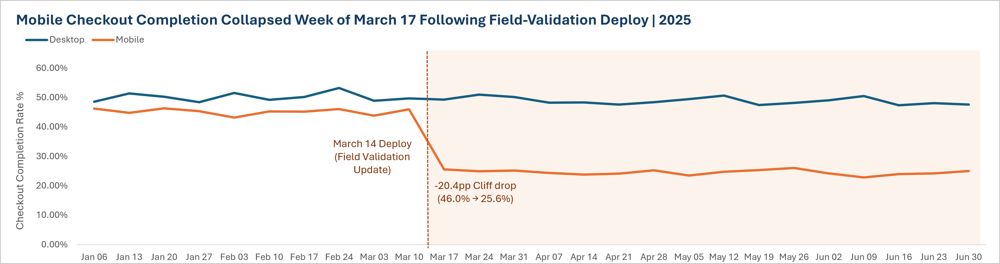
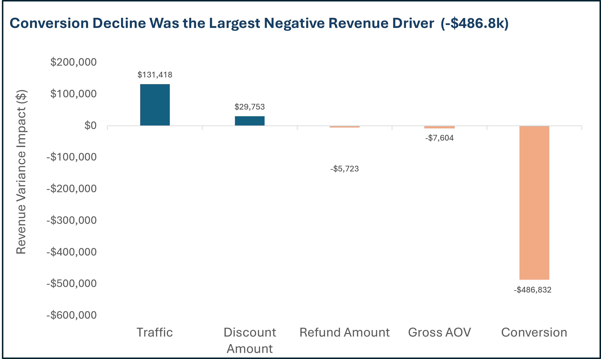
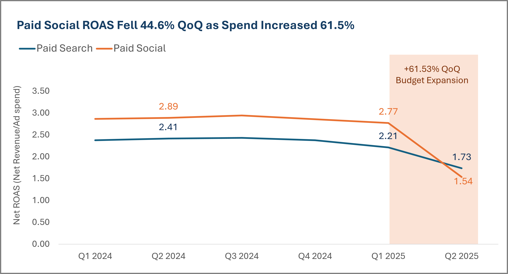
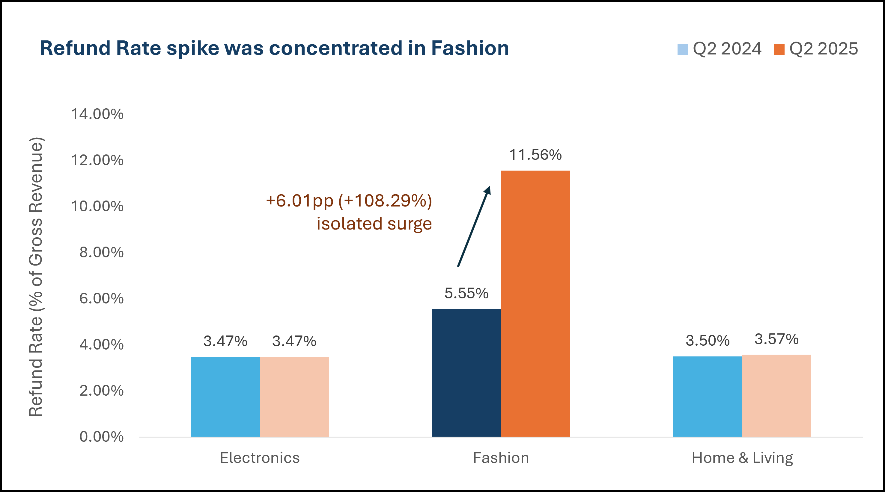

# Northstar Retail | Diagnostic Analytics Case Study

**Project type:** Independent data analytics portfolio  
**Reporting period:** Q2 2025 versus Q2 2024  
**Business context:** Multi-region e-commerce retailer operating in Lagos, Abuja and Port Harcourt  
**Primary tool:** Microsoft Excel (PivotTables, formulas, charts and financial decomposition)  

> **Quick takeaway:** The principal deterioration occurred in purchase conversion, especially mobile checkout completion. Paid marketing efficiency and Fashion refunds added pressure, but the evidence does not establish the precise technical cause of the mobile decline.

## Table of Contents

- [1. Project Overview](#1-project-overview)
- [2. Business Problem & Stakeholders](#2-business-problem--stakeholders)
- [3. Dataset Overview & Tools](#3-dataset-overview--tools)
- [4. Analytical Framework & Methodology](#4-analytical-framework--methodology)
- [5. Executive Summary](#5-executive-summary)
- [6. Key Findings & Visualizations](#6-key-findings--visualizations)
  - [6.1 Weekly Mobile Checkout Diagnosis](#61-weekly-mobile-checkout-diagnosis)
  - [6.2 Revenue Driver Decomposition](#62-revenue-driver-decomposition)
  - [6.3 Regional Mobile Revenue Losses](#63-regional-mobile-revenue-losses)
  - [6.4 Paid Marketing Efficiency](#64-paid-marketing-efficiency)
  - [6.5 Refund Rate by Category](#65-refund-rate-by-category)
- [7. Recommendations & Business Implications](#7-recommendations--business-implications)
- [8. Limitations & Further Investigation](#8-limitations--further-investigation)
- [9. Project Files & Deliverables](#9-project-files--deliverables)

---

## 1. Project Overview

Northstar Retail is a multi-region e-commerce case spanning **Lagos, Abuja and Port Harcourt**. The assignment was to understand *what changed, when deterioration began, where the revenue loss occurred and what management should investigate next*.

The analysis combines customer-funnel metrics, order and revenue performance, marketing spend, release timing and refund trends. It distinguishes documented performance deterioration from hypotheses about possible operational or technical causes.

**Scope:** Q2 2025 versus Q2 2024, with a weekly view used to investigate the March 2025 shift.

[↑ Back to Table of Contents](#table-of-contents)

## 2. Business Problem & Stakeholders

Northstar Retail is a multi-region e-commerce business operating across Lagos, Abuja, and Port Harcourt. In Q2 2025, net revenue declined by 24.5% YOY, from $1.385 million to $1.046 million, representing a loss of approximately $338,988, despite an 8.3% increase in website sessions. Meanwhile, paid marketing expenditure increased by 24.6%, raising concerns about declining marketing efficiency. 
Management therefore commissioned a diagnostic investigation to determine why increased traffic and advertising investment were not translating into revenue growth, identify when the deterioration began, establish the primary business drivers, and recommend evidence-based corrective actions.

| Business measure | Q2 2024 | Q2 2025 | Movement |
|---|---:|---:|---:|
| Net revenue | $1,384,637 | $1,045,650 | **−24.5%** |
| Website sessions | 485,220 | 525,604 | **+8.3%** |
| Purchase conversion | 3.10% | 2.22% | **−28.5% relative** |
| Paid net ROAS | 2.61× | 1.63× | **−37.6% relative** |

The **VP of Growth** wanted to know what was happening, when the problem started, which segments drove it and what the team should do next. Other stakeholders proposed explanations to test rather than assume:

| Stakeholder | Initial explanation |
|---|---|
| Marketing | Traffic quality may have deteriorated |
| Product | Seasonality may explain the change |
| Operations | Returns may be the main problem |
| Finance | Marketing spend may be rising faster than revenue |

[↑ Back to Table of Contents](#table-of-contents)

## 3. Dataset Overview & Tools

The project combines three principal data sources described in the [Data Dictionary](data/data_dictionary.md):

| Source | Role in the analysis | Grain / analytical caution |
|---|---|---|
| `weekly_performance` | Traffic, funnel activity, orders, revenue, discounts and refunds | Week × region × channel × device × category |
| `marketing_spend` | Spend, impressions and clicks | Week × region × channel; **coarser** than performance data |
| `release_log` | Timing context for website changes | Release-event grain; not causal proof |

**Tooling actually used:** Microsoft Excel, PivotTables, formula-backed KPI calculations, segmentation, trend charts and revenue decomposition.

**Important modelling decision:** Performance must be aggregated to **week × region × channel** before being compared or joined with marketing spend. Directly joining lower-grain performance rows to marketing-spend rows would multiply expenditure.

> The complete calculations and detailed PivotTable outputs are preserved in the [workbook](workbook/Northstar_Retail_Diagnostic_Analytics.xlsx). The public workbook may contain more supporting worksheets than are summarised here.

[↑ Back to Table of Contents](#table-of-contents)

## 4. Analytical Framework & Methodology

The analysis follows **V → T → D → B → C**:

1. **Validate:** Check data integrity, source grains, KPI definitions and calculations.
2. **Trend:** Compare Q2 periods and locate the weekly structural break.
3. **Decompose:** Separate traffic, conversion, order value, discounts and refunds; then segment by device, channel and region.
4. **Benchmark:** Compare against prior-period performance and stakeholder hypotheses.
5. **Conclude:** Rank the drivers, identify evidence gaps and recommend next investigations.

[↑ Back to Table of Contents](#table-of-contents)

## 5. Executive Summary

Northstar Retail's Q2 2025 net revenue fell **24.5% (approximately $339K)** even as website sessions grew **8.3%**. Purchase conversion declined **28.5% relative** and mobile checkout completion deteriorated sharply after mid-March, while desktop remained broadly stable. The revenue-driver bridge attributes a **−$486.8K conversion contribution**, partly offset by **+$131.4K from traffic growth**.

Paid marketing spend increased **24.6%** while paid-channel net revenue fell **22.2%**, reducing net ROAS from **2.61× to 1.63× (−37.6%)**. Fashion's refund rate also increased from approximately **5.55% to 11.56%**, although the refund component in the modelled revenue bridge was much smaller than the conversion contribution.

**Decision:** Prioritise technical diagnosis of mobile checkout, review paid-media allocation while the funnel is impaired and investigate the Fashion refund spike separately. Do not attribute the checkout decline to the March release without additional technical or controlled evidence.

[↑ Back to Table of Contents](#table-of-contents)

## 6. Key Findings & Visualizations

The dashboard above provides the consolidated executive view. The complete charts and evidence discussion are in the [seven-page presentation](report/Northstar_Retail_Diagnostic_Analytics_Presentation.pdf).

### 6.1 Weekly Mobile Checkout Diagnosis

Mobile checkout completion dropped from around **46.0% to 25.6%**, approximately **−20.4 percentage points**, in the week commencing **17 March 2025**. Desktop checkout completion remained near **49%**. A field-validation update was released on **14 March 2025**.

**Interpretation:** The device-specific timing makes mobile checkout the highest-priority technical investigation, but proximity to a release does not establish causation.

**Action:** Investigate validation errors, browser/device issues, payment paths and session continuity. Use controlled testing or rollback evidence.

### 6.2 Revenue Driver Decomposition

Conversion represented **97.3% of the negative components** of this revenue bridge. That percentage **does not** mean 97.3% of the final net revenue decline; positive contributions offset some of the negative ones.

| Modelled driver | Contribution to Q2 revenue change |
|---|---:|
| Traffic | +$131,418 |
| Conversion | **−$486,832** |
| Gross AOV | −$7,604 |
| Discount amount | +$29,753 |
| Refund amount | −$5,723 |
| **Net movement** | **−$338,988** |

**Action:** Validate checkout performance improvements before committing additional acquisition spend.

### 6.3 Regional Mobile Revenue Losses

The decline occurred across all three regions. **Lagos has the greatest absolute financial exposure**, but the cross-region pattern suggests a shared mobile-checkout investigation is more useful than treating the issue as Lagos-specific.

| Region | Mobile revenue loss | Share |
|---|---:|---:|
| Lagos | $172.6K | 46.0% |
| Abuja | $106.6K | 28.4% |
| Port Harcourt | $96.2K | 25.6% |

**Action:** Prioritise Lagos by financial impact while testing across all markets.

### 6.4 Paid Marketing Efficiency

Paid spend increased **24.6%** while paid-channel net revenue declined **22.2%**. Overall net ROAS declined **37.6% YoY** (2.61× → 1.63×).

Paid Social ROAS declined approximately **44.6% QoQ** from **2.77× to 1.54×**, while its spending increased **61.5% QoQ**. The quarter-on-quarter Paid Social comparison should not be confused with the overall year-on-year paid-media comparison.

**Action:** Review marginal Paid Social expenditure, segment performance by device and reassess efficiency following verified checkout remediation.

### 6.5 Refund Rate by Category

Fashion's refund rate increased from **5.55% to 11.56%** (**+6.01 percentage points**). Electronics remained approximately **3.47%**, while Home & Living increased only slightly (**3.50% → 3.57%**).

**Interpretation:** The refund issue is concentrated in Fashion but is secondary to conversion in the modelled revenue decomposition.

**Action:** Examine return reasons, affected SKUs, sizing/product information and fulfilment records. The supplied analysis does not establish the specific cause of the Fashion refund increase.

[↑ Back to Table of Contents](#table-of-contents)

## 7. Recommendations & Business Implications

| Priority | Recommendation | What to measure |
|---|---|---|
| **Critical** | Diagnose mobile checkout failures and the March 14 deployment conditions | Checkout completion, browser errors, payment success, session drop-offs |
| **High** | Reassess Paid Social spend while mobile checkout performance is impaired | Net ROAS, spend, paid-channel conversion by device |
| **High** | Investigate Fashion refund drivers | Refund rate, return reasons, SKU and size patterns |
| **Ongoing** | Monitor recovery using pre/post comparisons and appropriate controls | Orders, net revenue, checkout completion, ROAS and refunds |

The recommendations are **proposed next actions**, not proven interventions with guaranteed financial recovery.

## 8. Limitations & Further Investigation

- The observation that deterioration followed the **14 March release** is not proof that the release caused it.
- The operational logs and controlled tests required to verify a technical defect are not included in this analysis.
- Fashion refund rates identify a concentrated issue, but reason codes and product-level evidence are needed to establish why it occurred.
- Revenue-bridge contributions are model-derived attribution under the workbook's methodology, not experimental causal estimates.

## 9. Project Files & Deliverables

| File | What it contains |
|---|---|
| [Excel analytical workbook](workbook/Northstar_Retail_Diagnostic_Analytics.xlsx) | PivotTables, validation, source data, decompositions and dashboards |
| [Executive presentation (PDF)](report/Northstar_Retail_Diagnostic_Analytics_Presentation.pdf) | Seven-page decision-oriented overview |
| [Dashboard preview](visuals/Executive_Dashboard.png) | High-level executive dashboard |
| [Case brief](data/case_brief.md) | Business context, stakeholder request, analytical scope and KPIs |

**Note on reproducibility:** Open the workbook in Microsoft Excel to inspect PivotTables, formula-backed calculations, visualisations and source tables. The README explains the business logic and principal analytical decisions; it is not a substitute for the underlying workbook.

[↑ Back to Table of Contents](#table-of-contents)
